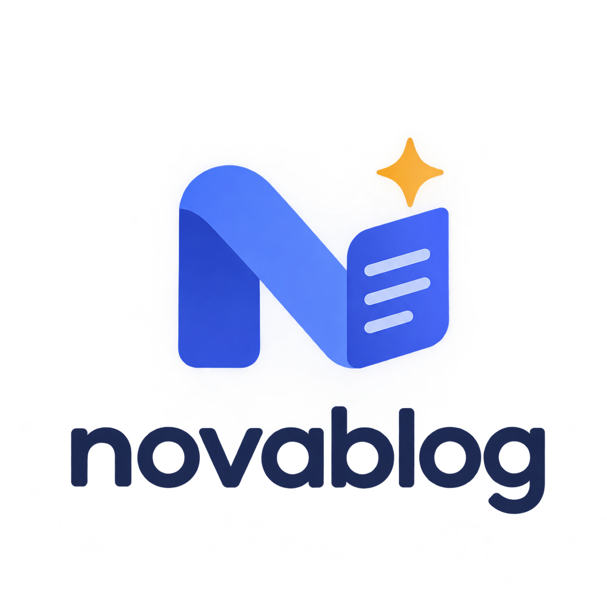

<div align="center">



# NovaBlog CMS

**趣味と職業に合わせてすべてをプリセットするオープンソースブログシステム —— コンテンツは CMS、見た目はテーマ、執筆は AI が**

<p>
  
  
  
  
  
  
</p>

[公式サイト](http://www.novablog.cn) · [無料登録](http://www.novablog.cn/register) · [作者のブログ](http://czf.ditancafebar.cn) · [テーマリポジトリ](https://github.com/StudyNoWeekend/novablog-web) · [Docker イメージ](https://github.com/StudyNoWeekend/novablog-cms/pkgs/container/novablog-cms) · [Skill ドキュメント](https://github.com/StudyNoWeekend/novablog-cms/blob/main/frontend/public/docs/novablog-api.md)

</div>

<div align="center">

**言語**：[简体中文](README.md) · [繁體中文](README.zh-TW.md) · [English](README.en.md) · 日本語 · [한국어](README.ko.md)

</div>

---

## 🎯 3 ステップであなたのブログを

コードもサーバーの知識も不要です：

1. **ブログを開設** —— [公式ホスティングに申請](http://www.novablog.cn/hosting#apply)すればゼロデプロイですぐに使えます。完全に自分で管理したい場合は、下の「[デプロイ](#-デプロイ2つの方法)」セクションに従って Docker でセルフホスト；
2. **初期設定ウィザード** —— アカウント作成 → **クリエイターの方向性を選択** → ストレージ設定 → デフォルトテーマを自動インストール。クリック数回で完了；
3. **創作スタート** —— 記事を書き、写真を上げ、レシピを公開し、旅を記録……選んだ方向性によってバックエンドにプリセットされるモジュールが決まり、後からいつでも変更できます。

初期設定が終わればアクセス可能な完全なブログの完成です。CMS がブログページを直接ホストし、訪問者には選んだテーマが表示され、コンテンツデータはそのまま保持されます。

### 趣味 / 職業に合わせてカスタマイズ：クリエイターの方向性

初期設定ウィザードの第 2 ステップでは **17 枚の「クリエイターの方向性」カード**（複数選択可）が表示され、好きなものを選ぶと対応するモジュールが自動で有効になります。1 つも選ばなければすべて有効になります。ログイン後もバックエンド上部からいつでも変更できます。

| グループ | 方向性 |
|------|----------|
| 技術 · デジタル | 技術開発者 · デジタルレビュー |
| 写真 · サウンド | 写真愛好家 · 動画クリエイター · ミュージシャン · トラベル Vlogger |
| 旅行 · ライフ | トラベルブロガー · グルメ愛好家 · フィットネス · ファッションコーデ · ペットの日常 |
| 趣味 · コレクション | 読書 · ゲーマー · デザイナー/イラストレーター · ハンドメイド DIY |
| 特別 | ライフスタイル · オールラウンドクリエイター（全モジュールを一括有効化） |

---

## 🧩 モジュール一覧

バックエンドのモジュールは「システム設定 → モジュール管理」でいつでもオン/オフでき、オフにするとブログ側とバックエンドメニューの両方から非表示になります（記事モジュールは常時有効、メディアライブラリは基盤として常に利用可能）。

### ✍️ コンテンツ作成（好きなものを選んで導入）

| モジュール | 提供されるもの |
|------|----------|
| 📝 記事管理 | Markdown / リッチテキストのデュアルエディター、カテゴリーとタグ、下書き/公開/公開停止、SEO（スラッグ・概要・カバー・キーワードのカスタム）、閲覧統計、公式コミュニティへワンクリック投稿 |
| 📸 フォトポートフォリオ | テーマごとにまとめた写真集、EXIF 撮影情報の自動抽出、複数のカバー スタイルとウォーターマーク保護 |
| 🗺️ 旅行ガイド | 構造化された複数日行程エディター、Amap / Google マップでの位置指定と詳細ページのマップ表示、いいねと人気レコメンド |
| 🍳 レシピ | 食材と調理手順の管理、公式コミュニティへワンクリック投稿 |
| 📖 本棚 | 蔵書・評価・書評、Douban 図書情報との連携に対応 |
| 🎮 ゲームライブラリ | ゲーム収蔵・プレイ時間・ひとことレビュー、Bangumi エントリとの連携に対応 |
| 💪 フィットネス | トレーニング記録の管理とブログ側での表示 |
| 🎵 音楽プレイリスト | 楽曲をアップロードしてプレイリストを作成、B 站リンクを貼り付けて自動解析再生、NetEase Cloud / QQ 音楽 / Spotify の公開プレイリストをインポート |
| 🎥 動画作品 | 動画と多対多アルバム管理、B 站リンクの解析埋め込み |

### 👤 私について（個人カードを作る）

| モジュール | 提供されるもの |
|------|----------|
| プロフィール | ニックネーム・アバター・自己紹介、ブログタイトル/説明/背景、20+ の SNS プラットフォームリンク（ブランドカラーアイコン内蔵） |
| デバイス管理 | デジタル/カメラ機材リスト、写真アップロード時に撮影情報を自動認識 |
| プロジェクト経験 | オンライン履歴形式のプロジェクト経歴：分野・役割・技術スタック・期間 |
| 技術スタック | スキルタグ管理、ブログ側では公式ブランドアイコンで表示 |
| オープンソース作品 | GitHub オープンソースプロジェクトの展示カード、公式コミュニティへワンクリック投稿 |

### 🧰 インフラ（初期状態で内蔵）

| モジュール | 提供されるもの |
|------|----------|
| ダッシュボード | アクセス数/コンテンツ数の指標、モジュール別コンテンツカード、ECharts トレンドチャート |
| コメント管理 | 記事や旅行ガイドなどからの訪問コメントを集約、3 段階審査、ネスト返信、IP ブラックリスト |
| メディアライブラリ | 画像/動画/音声アップロード（大ファイル分割）、フォルダ管理、サイズプリセットワークベンチ、外部画像の取り込みと検索 |
| テーママーケット | 公式テーマの閲覧・プレビュー・ワンクリックインストール（下のテーマセクション参照） |
| システム設定 | モジュールスイッチ、オブジェクトストレージ（ローカル/MinIO/Aliyun OSS/騰訊 COS のホットスイッチと移行）、CORS、マップ Key、IP ブラックリスト、コミュニティ配信 |
| アクセス統計 | ブログ側の訪問者 IP 統計、ip2region オフライン位置情報解析、外部サービス不要 |
| API ドキュメント / MCP サービス | 認証不要の公開 API オンライン閲覧、Skill ドキュメントのダウンロード、MCP キー管理（下の AI セクション参照） |

---

## 🤖 AI に書かせる：MCP + Skill

NovaBlog CMS には **MCP Server** と **Skill 形式の API ドキュメント**が内蔵されており、Codex、ZCode、Claude Code、Cursor などの AI エージェントがあなたのブログ上で直接コンテンツを作成できます——あなたは口で指示するだけ。

### 方法 1：MCP 接続（推奨：書く・公開する・管理する）

バックエンド「AI → MCP サービス」で 3 ステップ：

1. **キーを発行**：セルフサービスで MCP API Key を開通（`nbt_mcp_` プレフィックス、有効期限の設定可、レート制限内蔵）；
2. **設定を貼り付け**：ページが自動生成する JSON をコピーし、AI クライアントの MCP 設定に貼り付け：

```json
{
  "mcpServers": {
    "novablog": {
      "type": "http",
      "url": "https://あなたのブログドメイン/api/v1/mcp",
      "headers": {
        "Authorization": "Bearer nbt_mcp_あなたのキー"
      }
    }
  }
}
```

3. **創作を依頼**：「XX テーマの記事を書いて公開して」と AI に頼むだけです。

MCP エンドポイントは Streamable HTTP（`/api/v1/mcp`）、現在 **93 ツール**を提供し、管理コンソールの全コンテンツモジュールをカバーしています（削除操作はすべて誤操作防止のため明示的な `confirm=true` が必要）：

| ドメイン | ツール |
|------|------|
| 記事管理 | `list_articles` / `get_article` 照会；`create_article` 作成（Markdown 本文、概要、タグ/カテゴリー自動作成、カバー、ステータス）；`update_article` 編集；`set_article_status` 公開 / 下書き / 公開停止；`delete_article` 削除 |
| メディアライブラリー | `upload_image` アップロード（http リンク自動転送または base64、`module` でコンテンツモジュール別に整理）；`list_media` / `list_media_folders` ファイルとフォルダー照会；`move_media` 移動；`delete_media` 削除（参照中は `force=true`） |
| カテゴリーとタグ | `list_categories`（12 種類のモジュールタイプ対応）/ `create_category` / `update_category` / `delete_category`；`list_tags` / `create_tag` / `update_tag` / `delete_tag` |
| 私について | `get_profile` / `update_profile` ブロガープロフィール；機材 `list_/create_/update_/delete_equipment`；プロジェクト経歴 `*_project`；技術スタック `*_tech_stack`；オープンソース `*_open_source` + `refresh_open_source` でリポジトリ情報を再取得 |
| コンテンツ制作 | プレイリスト `*_playlist`；動画作品 `*_video` + `parse_video_url` 事前解析；旅行ガイド `*_travel` + `set_travel_status`；写真ポートフォリオ `*_portfolio` + 作品項目 `add_/update_/delete_portfolio_item` / `sort_portfolio_items`；レシピ `*_recipe`；読書 `*_book`；ゲーム `*_game`；フィットネス `*_fitness_record` |
| コメント管理 | `list_comments` 照会；`reply_comment` ブロガーとして返信；`delete_comment` 削除（返信も連動削除） |
| ダッシュボード（読み取り専用） | `get_dashboard_overview` 概況とトラフィックサマリー；`get_dashboard_trend` 制作/トラフィック推移（7d/30d/90d）；`get_top_content` 人気コンテンツランキング |

### 方法 2：Skill ドキュメント（AI にすべての公開 API を習得させる）

バックエンド「AI → API ドキュメント」ページから **SKILL.md 形式の API リファレンス**（[novablog-api.md](frontend/public/docs/novablog-api.md)）をダウンロードし、Claude Code / Cursor / ZCode などの AI アシスタントのワークスペースに置けば、認証不要の全公開 API のパス・パラメータ・レスポンス例を習得し、テーマ制作・統合・一括データ取得を支援します。

---

## 🏠 公式エコシステム：NovaBlog 公式サイトと CMS の関係

ひとことで言うと：**CMS はあなた自身のブログの中核、公式 NovaBlog サイトはあなたのコンテンツコミュニティです。**

- **NovaBlog CMS（本プロジェクト）**：セルフホスト型のオープンソースブログシステム。コンテンツ・見た目を管理し、ブログページを直接ホスト；
- **NovaBlog 公式サイト**：コミュニティポータル——公式アカウント体系、テーママーケット、コンテンツコミュニティ。CMS のテーママーケットとコミュニティ配信はいずれも公式サイトに接続；
- **公式アドレスの一元管理**：出荷時に内蔵、「システム設定 → コミュニティ配信」で確認・変更可能。テーママーケットとコミュニティ配信は同一エントリを共有し、サーバーが直接接続します。

| エントリ | URL | 用途 |
|------|------|------|
| 公式サイト | <http://www.novablog.cn> | コミュニティポータル · テーママーケット |
| 無料登録 | <http://www.novablog.cn/register> | 公式アカウントの開設：マーケットログイン、ホスティングデプロイ、配信キー |
| 公式 API | <http://api.novablog.cn> | コミュニティ配信とテーママーケットの統一サービスエントリ |

> バックエンド「システム設定 → コミュニティ配信」の公式アドレスは実際の設定が優先されます。

**コミュニティ配信**：記事・旅行ガイド・レシピ・フォトポートフォリオ・オープンソース作品の 5 種類のコンテンツをワンクリックで公式コミュニティに同期して露出を得られます——作成/更新後に自動で非同期配信、削除時に自動で公開停止、変更がなければ自動スキップ、失敗時は自動リトライ。編集ページの配信ボタンから手動再送信と同期状態の確認もできます。

---

## 🎨 テーマ：着替えるように見た目を変える

ブログのフロントエンドは丸ごと入れ替え可能な「テーマ」です。テーマは見た目と体験を、CMS はコンテンツとホスティングを担当します。テーマの切り替えはポインタを 1 つ更新するだけで、秒単位で反映、再起動不要、コンテンツはそのまま。

### 方法 1：公式マーケットからワンクリックインストール（推奨）

バックエンド「テーママーケット」で、多彩な公式テーマ（技術スタイル、フレームライフ、放浪世界、メロディノートなど 11+ 種類）を閲覧・検索・評価・お気に入り登録でき、選ぶだけです：

- **有効化前にプレビュー**：実際のレンダリングを確認（`/preview`）；
- **ワンクリックインストール**：ダウンロード → SHA256 検証 → セキュア展開検証 → `theme.json` マニフェスト検証を自動実行；
- **バージョン管理とワンクリックロールバック**。テーマは `theme.json` で設定項目を宣言し、バックエンドが自動でビジュアル設定パネルを生成。コードに触れずに設定を変更できます。

### 方法 2：ローカルマウントで自前のフロントエンドを使う

自前のフロントエンドを使いたい場合は、`theme.json` と `dist/` を含むディレクトリを CMS にマウントするだけ。改造ゼロで接続できます：ベアメタルでは `themes.frontend_dir` を設定、Docker では `./deploy.sh --frontend-dir <ディレクトリ>`。

### 🌍 テーマはオープンソース、一緒に作りましょう

公式テーマはすべてテーマリポジトリ [StudyNoWeekend/novablog-web](https://github.com/StudyNoWeekend/novablog-web) でオープンソース化されており、**公式 + コミュニティ共同メンテナンス**のオープンモデルを採用しています：公式が継続的に公式テーマを制作・メンテナンスし、コミュニティの作者は規範に従って独自のテーマを開発して Issue / PR を提出、公式マーケットを通じてすべてのブロガーに配信されます。

- テーマパッケージ仕様：[novablog-web/docs/theme-spec.md](https://github.com/StudyNoWeekend/novablog-web/blob/main/docs/theme-spec.md)
- パッケージングとリリースガイド：[novablog-主题包规范与发布指南.md](novablog-主题包规范与发布指南.md)

---

## 🚀 デプロイ：2つの方法

### 方法 1：公式ホスティング（ゼロデプロイ、初心者におすすめ）

[公式サイトで無料登録](http://www.novablog.cn/register)するだけでホスティングブログを開設できます。サーバーも Docker も不要で、登録後はセルフホストと同じ初期設定ウィザードが始まります。

### 方法 2：Docker でセルフホスト

シングルイメージに nginx のデュアルエントリ、Go バックエンド、管理画面フロントエンドを内蔵：`ghcr.io/studynoweekend/novablog-cms`（`linux/amd64` / `linux/arm64`）。PostgreSQL 15+ と Redis 7+ はご自身でご用意ください（スクリプトが接続性を事前チェックします）：

```bash
cd deploy
./deploy.sh --name myblog                        # 対話形式で残りの設定を入力
./deploy.sh --name myblog --yes \
  --db-host 10.0.0.5 --db-password '***' \
  --redis-host 10.0.0.5 --redis-password '***'   # 非対話で全デフォルト設定
```

起動後：ブログ入口 `http://<ドメイン>:80`、管理画面 `http://<ドメイン>:8080/admin/`。

| エントリ | デフォルトポート | 内容 |
|------|----------|------|
| ブログ入口 | `80` | 有効なテーマのページ（またはローカルマウントのフロントエンド）· `/preview` · `/api/v1` · `/files` |
| 管理画面 | `8080` | `/admin/` 管理バックエンド · `/api/v1` · `/files` |

よく使う運用コマンド：

```bash
./deploy.sh --name myblog --status    # コンテナ状態の確認
./deploy.sh --name myblog --logs      # アプリログの追跡
./deploy.sh --name myblog --down      # 停止してコンテナを削除（マウントデータは保持）
```

- `--name` は必須で、同一ホスト上の複数ブログを分離するキーです。名前とポートを変えれば同一ホストで共存できます；
- アップグレードは `./deploy.sh --name myblog --version vX.Y.Z` を再実行、マウントデータは保持されます；
- 完全なパラメータ、外部データベース、ホスト nginx リバースプロキシの説明は [deploy/README.md](deploy/README.md) を参照。

### ローカル開発

```bash
# 1. バックエンドを起動
cd backend
cp config/config.example.yaml config/config.yaml   # postgres/redis 接続とキーを編集
make run                                            # :8111、初回起動時に自動マイグレーション

# 2. 管理画面フロントエンドを起動
cd ../frontend
pnpm install && pnpm dev                            # :5173、/api は :8111 にプロキシ
```

ブラウザで `http://localhost:5173` を開くと初期設定ウィザードが自動で始まります。

---

## 🤝 コントリビュート

Issue と Pull Request を歓迎します：

1. バックエンドのコミット前に `make fmt && make vet && make lint` を実行；
2. フロントエンドのコミット前に `pnpm lint` を実行；
3. API を追加したら DTO と API ドキュメントを同時に更新。

---

## 📜 ライセンス

本プロジェクトは [MIT](LICENSE) ライセンスで公開されています。

---

## 🙏 謝辞

- [Gin](https://github.com/gin-gonic/gin) · [GORM](https://gorm.io) · [Vue.js](https://vuejs.org) · [Ant Design Vue](https://antdv.com) · [PostgreSQL](https://www.postgresql.org) · [Redis](https://redis.io)
- および本プロジェクトにインスピレーションと支援を与えてくれたすべてのコミュニティコントリビューターの皆さん

---

<p align="center">
  <sub>Made with ❤️ for independent bloggers</sub>
</p>
